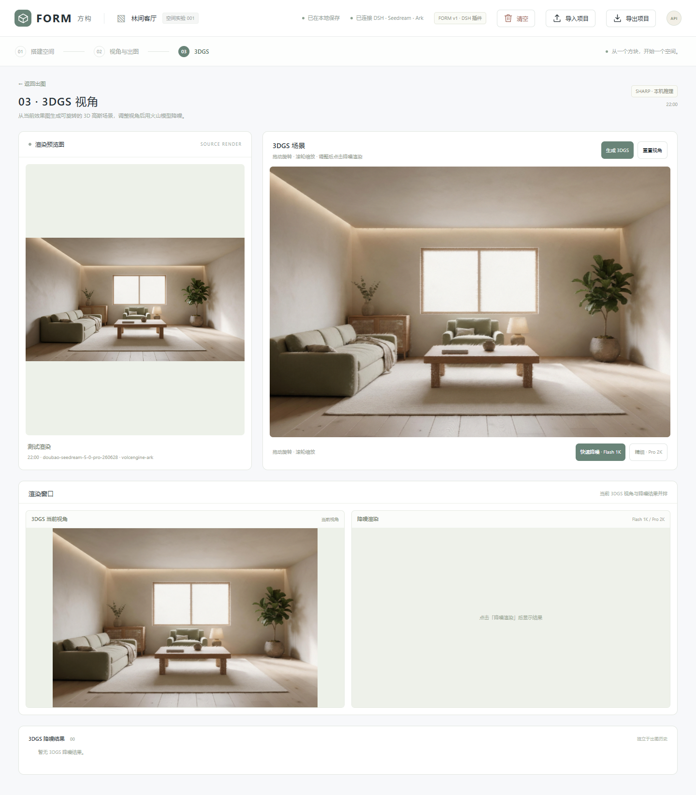

# FORM · 方构空间工作台

FORM 是一个面向室内空间的 AI 工作台：用体块搭建空间，锁定机位，用 Seedream 出图，再用 Apple SHARP 生成可旋转的 3DGS，并导出 AI 漫游视频。

> 这是 **源码仓库**，不包含 2.6GB 的 SHARP 模型、PyTorch/SHARP 运行环境、DeepSeek Harness 运行时和任何 API Key。源码可直接阅读和二次开发；完整安装包、3DGS 模型与运行环境需要单独构建或安装。

## 功能

- **01 搭建空间**：体块建模、墙体/窗户、组件库、机位、地面材质。
- **02 视角与出图**：机位体块参考 + 场景简报 + Seedream 出图，支持 1K/2K。
- **03 3DGS**：Apple SHARP 单图生成 3DGS；旋转、Shift+左键平移、滚轮/＋－缩放；Flash 1K / Pro 2K 降噪。
- **04 漫游**：四条预设路径，一键黑箱导出 1080p 30fps MP4（AI 关键帧 + 本地平滑编码）。
- **模型与 API Key**：按模型逐行配置火山方舟、OpenRouter、DeepSeek Key；本地 SHARP 可直接打开模型目录。

## FORM v1（当前）

原先的两处“本地模拟”已由 DSH 插件替换为真实能力；服务未启动时自动回退旧模拟，并在界面明确标注。

- **组件 Agent**：真实 DSH Agent 会话，模型 `deepseek-official / deepseek-flash`。Agent 通过 `form_component_create` 工具把描述转成受支持的组件（书架、沙发、桌子、门窗、绿植、花池、柜子、床、椅子、书桌、灯具、地毯），几何由 `dsh-plugin/lib/components.js` 确定性生成并校验。会话持久化在 `%USERPROFILE%\.dsh\sessions\--G-sp~0020ai-block-studio--\`，插件重启后可恢复多轮对话。
- **出图**：Seedream。主通道火山方舟 Ark（Pro `doubao-seedream-5-0-pro-260628` 用于 02 出图 / 03 精细降噪，Flash `doubao-seedream-5-0-flash-260915` 用于 03 快速降噪 / 04 AI 漫游），备选 OpenRouter（默认 `bytedance-seed/seedream-4.5`）。勾选“保持空间布局”时把当前机位体块预览 PNG 作为参考图（图生图）。没有密钥时不生成替代图，页面显示“Seedream 未配置”；Key 有效但模型未开通时显示“Seedream 模型未开通”。
- **托管方式**：独立 DSH profile `form`，端口 `52482`，与当前 GUI `52481`、旧预览 `4173` 隔离。插件包在 `block-studio/dsh-plugin`，页面和 API 同源。
- **历史**：场景/机位/提示词在浏览器 localStorage；Agent 会话在 DSH sessions；出图图片与参数在 `block-studio/assets/generated/`。从旧 `file://` 打开的数据可在新页面用“导入项目”迁移。
- **机位管理**：右侧“我的机位”支持添加当前视角（取景后保存）和删除；删除按钮在机位卡片右上角与出图页“删除当前机位”。至少保留一个机位；删除当前机位会自动切到下一个，Ctrl+Z 可撤销。
- **组件库管理**：Agent 生成/自定义组件卡片左上角有 ×，可从组件库删除；内置 6 个基础组件保留。删除不会移除已经放到场景里的实例；若该组件正在待放置状态，会先取消放置。
- **提示词方案**：内置英文正向（参考图只做位置/颜色参考，不复制方块风格）+ **精致度规则**（材质细节、木纹/布纹/石材、金属五金、玻璃反射、自然光+实用光、环境光遮蔽、软阴影、少量陈设）+ 实时英文场景简报（逐个对象列出）+ 中文用户描述 + 内置英文负面/可追加负面；用户描述仍然控制风格/氛围，内置规则只提升细节与真实度。出图页可勾选“允许人物”，并可“查看最终提示词”（不生成、不产生费用）。
- **场地尺度**：右侧“场景概览”的宽/深改为可输入（2–30m，0.5m 步进）；改尺寸时地板、碰撞边界、相机中心和缩放自动适配，家具保持真实尺寸和世界位置不变；缩小场地时若有组件超出边界会提示。
- **一键清空**：顶栏“清空”会确认后恢复 7.0×6.0m 空场地，并清空机位、预设、出图历史、自定义组件库和底图；Ctrl+Z 可撤销这次清空。
- **拖动建墙**：选“结构 → 墙体模块”后，在地面按住左键拖动即可建墙；厚度/高度固定，长度按拖动直线计算并向上取整（不足一格按一格），方向按 **30° 极轴**吸附；实时显示长度预览、边界校验/重叠标红；生成一条连续墙体，保持建墙模式可连续拖。
- **窗户**：选“结构 → 窗框”后只能点击垂直墙面放置（地面会提示）；自动吸附到墙内，窗台/窗高可设置；墙体自动按窗洞分段挖空，窗户不受普通模型碰撞限制；放置后可沿墙面拖动/上下移动，墙洞跟随；不能旋转/缩放/离开墙面；删除窗户后墙体自动恢复。
- **旋转极轴**：体块旋转时角度在 30° 倍数 ±4° 内自动吸附；超出 ±4° 自由旋转；按住 Shift 仍按 15° 精确吸附。
- **重叠与吸附**：取消组件之间的硬碰撞，允许重叠；重叠对象实时红色描边/淡红高亮；地面下限和地板边界仍保留；松开时仍做 40mm 轻微吸附。
- **视角旋转**：参考 SketchUp：按住鼠标中键在模型上拖动，以按下位置的 3D 点为旋转中心，该点在屏幕上保持不动、画面不跳；Shift+左键平移；滚轮或＋－按钮缩放。
- **地面设置**：结构栏新增“地面设置”卡片，打开独立窗口可改地面宽度/深度/厚度/颜色/材质；也可输入文字让地面 Agent 生成对应材质，再应用。
- **渲染模块简化**：移除分层拆分、图层固定、风格图集、固定效果图栏和图层相关 API；出图只保留当前机位体块参考、场景简报、用户描述、负面词和最终提示词预览。
- **出图历史**：不再写入预生成示例；每张历史缩略图右上角有删除按钮，删除后同步清理对应图片文件。
- **03 3DGS 视角**：双击出图主图或历史缩略图进入；左侧保留原渲染图，右侧用本机 Apple SHARP 模型从该图生成可旋转 3D Gaussian Splatting（Shift+左键平移）；调整视角后可快速降噪（Flash 1K，默认）或精细降噪（Pro 2K），结果进入页面3独立历史。安装包已包含 2.8GB SHARP 模型；PyTorch/SHARP 运行环境仍需本机具备。
- **04 漫游视频**：独立的 04 页面（顶部流程第 4 步）；内置推进/环绕/抬升/横移四条预设路径；一键黑箱导出 1080p 30fps MP4：关键帧走 Seedream Flash 1K 去噪，再与原始 3DGS 路径做时间平滑，无预览。
- **模型与 API Key**：顶部 API 按钮打开可点击的模型列表，逐行展开配置：Seedream Pro / Flash 填火山方舟 Key，Seedream 4.5 备用填 OpenRouter Key；SHARP 可打开本地模型文件夹；DeepSeek 可填写 API Key（无 DSH 时直连 deepseek-chat）或打开 DSH 配置文件夹。
- **编码修复**：`app.js` 已从 `FORM-preview.html` 中恢复为正确的 UTF-8 中文（原文件是 mojibake），并新增 `form-bridge.js` 负责 API 接入与状态标注。

安装、密钥、API、验证和限制详见 [`dsh-plugin/README.md`](dsh-plugin/README.md)；逐步申请指南见 [`docs/Seedream-Key-Guide.md`](../docs/Seedream-Key-Guide.md)。启动/停止/重启：本地开发脚本位于仓库上一级目录；密钥文件为运行目录下的 `.form-secrets.json`（示例 `.form-secrets.example.json`）。

## v0.2 本地模拟更新

v0.3 更新（优先于下方旧操作说明）：中键以点击点为中心旋转，Shift+左键平移。放置和缩放按实际底面自动落地，主动 Z 平移可抬高；地面下限和地板边界保留，组件间不再硬碰撞，重叠实时标红，40mm 轻微吸附保留。运行 `node test-physics.cjs` 验证。

需求见 REQUIREMENTS.md。v0.3 及以前不接入 DeepSeek、Seedream 或任何外部工具；FORM v1 由 DSH 插件接入。

- 中键以按下位置为中心环绕旋转；Shift+左键平移；滚轮或＋－缩放视图。左键选中对象，右键或 Esc 取消选择/放置。
- W/E/R 切换移动、旋转、缩放，拖动彩色 X/Y/Z 轴或旋转环编辑；也可以用右侧数值面板。Shift 吸附，Delete 删除，Ctrl+Z 撤销。
- 组件库选中组件后左键放置一次，自动进入对象选择状态；右键取消待放置组件。
- 新增正视、俯视、轴测快捷视图。
- 组件 Agent 在 FORM v1 使用真实 DSH Agent（服务不可达时回退本地关键词/模板模拟），支持书架、沙发、桌子、门窗、绿植和花池，尺寸与颜色可指定；结果可加入库并放置。
- 当前为 Canvas 变换交互模拟，不是完整 3ds Max 或正式建模引擎。

验证：`node test-v2.cjs`。打包：`node package-preview.cjs`。

## 原始预览操作（v0.1，鼠标与快捷键以 v0.2 为准）

- 拖动旋转，滚轮缩放；选择构件后点击地板放置，点击方块顶面堆叠。
- V 浏览 / B 放置 / E 删除；Ctrl+Z 撤销。放置模式按 Alt 拖动也能旋转。
- 点击「添加当前视角」，调整透视取景并保存；点击机位标记进入出图页。
- 出图页可以切换和保存提示词预设、调整机位、查看底图、演示生成、下载示例图。
- 支持导入 PNG/JPG 平面图作为地面参考；当前按地板范围缩放，未实现尺寸标定或自动识图。
- 场景、机位、提示词及历史参数保存在浏览器 localStorage；可导出 JSON。

## 实现范围

这是 HTML 本地交互原型，体块使用自制 Canvas 3D 投影渲染；这不是工程精度的建模内核。当前支持放置、删除、撤销、对象变换、重叠标红、吸附和落地约束，不包含自动识图、多图批量生成。

FORM v1 通过 `dsh-plugin` 接入 DSH Agent 与 Seedream；真实出图受平台额度、模型可用性和网络影响。插件未连接时，组件 Agent 回退本地模板、出图页保留内置示例图并明确标注，不会伪称 Seedream 输出。

## 示例图片

`assets/living-room.png` 使用内置 imagegen 工具生成，不是 Seedream 4.0 实际输出。真实出图保存在 `assets/generated/`。

生成提示词：

Use case: photorealistic-natural. Generate one beautiful architectural interior photograph for a spatial design application demo. Landscape 3:2 composition. A warm minimal Japanese Scandinavian living room, cream modular sofa along the left wall, low rectangular oak coffee table in the center, textured ivory rug, olive green upholstered armchair at right, tall indoor tree near back right corner, large rectangular window on rear wall admitting soft afternoon sun, pale plaster walls, oak floorboards, subtle books and ceramic bowl. Eye-level wide angle view looking toward rear corner, refined editorial architecture photography, realistic materials and soft shadows, no people, no text, no watermark. Save image for use as a demo rendering; no UI.

## 开发

### 旧版本地预览

`node server.cjs` 启动 http://127.0.0.1:4173 。

`node package-preview.cjs` 将源代码和图片打包为独立 HTML。

### DSH 插件

- 页面：`index.html` + `app.js` + `physics.js` + `editor-v2.js` + `form-bridge.js`
- 插件：`dsh-plugin/lib/index.js`（HTTP/Agent）、`components.js`（几何）、`render.js`（Seedream）
- 插件配置：`dsh-plugin/cordis.patch.yml`
- profile：`C:\Users\ASUS\.dsh\profiles\form`
- 回归脚本：`dsh-plugin/test/`（mock Ark、CDP 驱动）

## License

MIT License — see [LICENSE](LICENSE).

Third-party libraries and models are listed in [THIRD_PARTY_NOTICES.md](THIRD_PARTY_NOTICES.md).
